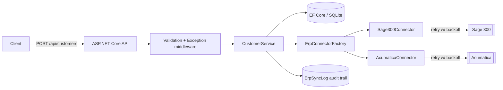

# ERP Integration Service

> A C#/ASP.NET Core reference implementation of a resilient integration service that syncs
> internal business records to external ERP platforms (**Sage 300** and **Acumatica**).


> ℹ️ **About this project:** This is an **independent reference implementation** of a pattern I
> built and owned in production (C#/.NET ERP integrations with Sage 300 and Acumatica, 2020–2024).
> The original source is proprietary / under NDA — **no confidential code or data is used here.**
> This repo re-creates the *architecture and engineering practices* with original code and
> synthetic data so the approach can be shared publicly.

---

## 📌 Overview

Business applications constantly need to push records (customers, invoices, payments) into ERP
systems that each speak a different API dialect. This service provides **one internal REST API**
that validates, normalizes, maps, and reliably delivers records to the correct ERP — with retries,
an audit trail, and a pluggable connector model that makes adding a new ERP a one-line change.

- **Domain:** Business-system / ERP integration
- **Role modeled:** Senior Backend Engineer (API design, integration, data mapping, resilience)

---

## 🎯 Problem it solves

- Each ERP (Sage 300, Acumatica, …) has a different schema and failure behaviour.
- Integrations must be **idempotent-friendly, observable, and resilient** to transient faults.
- A failed push must never lose the record — it must be persisted and auditable for retry.

---

## 🏗 Architecture

Clean/onion architecture — dependencies point inward, so the domain and application logic never
depend on EF Core, the web host, or any specific ERP SDK.



| Layer | Responsibility |
| --- | --- |
| **Domain** | Entities (`Customer`, `ErpSyncLog`) and their state transitions — no dependencies |
| **Application** | Use cases, DTOs, validation, mapping, and the `IErpConnector` / repository abstractions |
| **Infrastructure** | EF Core persistence + the ERP connectors and resilience policy |
| **Api** | Controllers, exception-handling middleware, DI composition |

### Key design decisions

| Decision | Why | Tradeoff |
| --- | --- | --- |
| Connector abstraction + factory | Adding an ERP = register one class; no changes to callers | Slight indirection |
| Persist-then-sync with status | A failed ERP push never loses the record (stored as `Failed`) | Eventual consistency |
| Polly retry on transient faults only | ERP timeouts/5xx are retried; business rejections are not | Must classify errors |
| DbContext as unit of work | One transaction per request, simple and explicit | Context lifetime tied to scope |

---

## 🛠 Tech Stack

- **Language/Runtime:** C# 12, .NET 8
- **Web:** ASP.NET Core (controllers), Swagger/OpenAPI
- **Persistence:** Entity Framework Core 8 (SQLite locally; swap the provider for SQL Server)
- **Validation:** FluentValidation
- **Resilience:** Polly (exponential backoff retry)
- **Testing:** xUnit, Moq, FluentAssertions, `WebApplicationFactory` + EF InMemory
- **CI:** GitHub Actions (restore → build → test)

---

## ✨ Features

- `POST /api/customers` — validate, persist, map, and sync a customer to the target ERP
- `GET /api/customers/{id}` — fetch a customer and its sync state
- `GET /api/customers` — list customers (newest first)
- Transient-fault **retry with exponential backoff**; permanent ERP rejections are not retried
- **Audit log** of every sync attempt (ERP, result, attempts, reference, message)
- Consistent JSON **problem responses** via centralized exception middleware

---

## 🔥 Engineering highlights

### Pluggable ERP connectors
`IErpConnector` exposes its `System`; all implementations are registered as a set and resolved
by `ErpConnectorFactory`. Supporting a new ERP means adding one `ErpConnectorBase` subclass — no
changes to the service or controllers.

### Resilience without leaking into business logic
`ErpConnectorBase` wraps each push in a Polly retry pipeline and classifies failures:
`ErpTransientException` is retried with backoff; `ErpRejectedException` fails fast. The
`CustomerService` just sees a clean `ErpSyncResult` and records the outcome.

### No lost records
The customer is persisted first and its status is derived from the sync result, so an ERP outage
leaves a `Failed` record plus an audit entry that a background job could later retry — rather than
a 500 and a dropped record.

---

## 🚀 Getting started

```bash
# Requires the .NET 8 SDK
dotnet restore
dotnet run --project src/ErpIntegration.Api
# Swagger UI: https://localhost:<port>/swagger
```

### Try it

```bash
curl -X POST https://localhost:5001/api/customers \
  -H "Content-Type: application/json" \
  -d '{ "name": "Contoso Ltd", "email": "ap@contoso.com", "targetErp": 1 }'
# targetErp: 1 = Sage 300 (-> AR-######), 2 = Acumatica (-> CUST######)
```

---

## ✅ Tests

```bash
dotnet test
# 14 tests: unit (validation, mapping, service, retry) + integration (full HTTP pipeline)
```

---

## 🗺 Possible extensions

- Invoice & payment sync reusing the same connector model
- Background retry worker for `Failed` records (outbox pattern)
- Real Sage 300 Web API / Acumatica contract-based API clients behind the existing interfaces
- SQL Server provider + EF Core migrations for production

---

*This repository demonstrates architecture and engineering practices only. It contains no
proprietary source code, data, or confidential information from any employer or client.*
